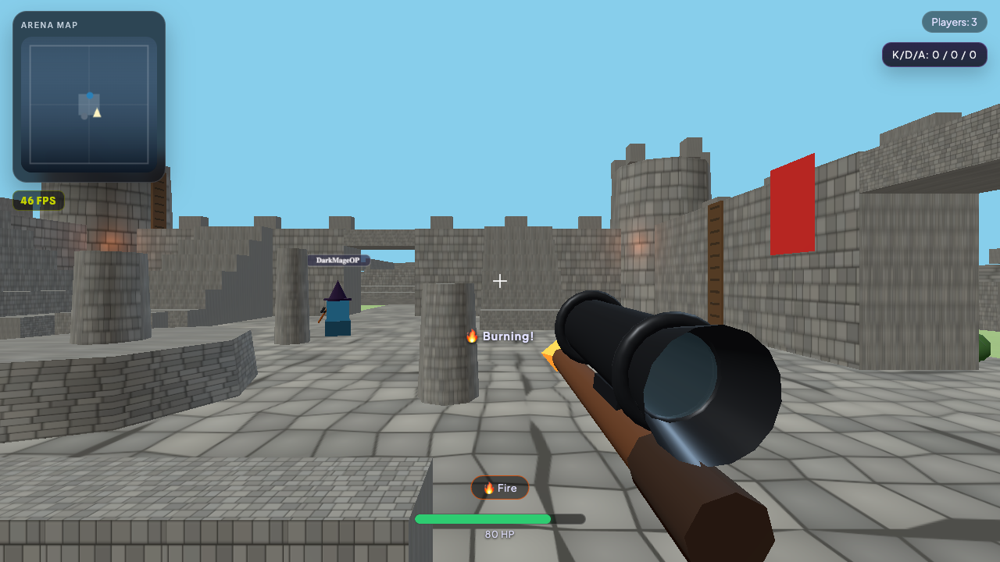
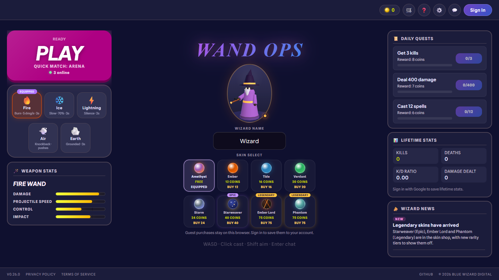

# Wand Ops

A multiplayer wizard first-person shooter that runs in the browser. Cast elemental spells at other players (and AI bots) in a castle arena.

Built with [Three.js](https://threejs.org/) and [Vite](https://vitejs.dev/). Multiplayer uses [Photon Realtime](https://www.photonengine.com/), and sign-in and saved stats use [Firebase](https://firebase.google.com/). It deploys to [Vercel](https://vercel.com/).



[▶ Watch the gameplay demo (mp4)](docs/demo.mp4)

## Features

- **Quick Match arena**: a castle with walls, climbable towers, stairs, ladders and raised platforms, plus courtyard cover, ruins and boulders to fight around. Respawns pick a spot away from enemies.
- **Five spells**, each with its own effect:

  | Spell | Effect |
  | --- | --- |
  | 🔥 Fire | Burns for 5 damage a second for 3s |
  | ❄️ Ice | Slows the target by 70% for 3s |
  | ⚡ Lightning | Silences the target (no casting) for 2s |
  | 💨 Air | Knocks the target back |
  | 🪨 Earth | Grounds the target (no jumping) for 3s |

- **Bots** fill the lobby to three combatants: 1 human gets 2 bots, 2 humans get 1 bot, and 3 or more humans get none. The lowest-numbered human runs the bots and everyone else mirrors them.
- **Coins and skins**: every kill earns a coin and daily quests pay more. Spend coins on skins in four rarity tiers, from common recolours up to Epic and Legendary skins with glowing patterns or a translucent robe.
- **Sound**: synthesized sound effects, including a distinct hit sound for each spell, a kill chime and a low-health heartbeat.
- **Settings**: mouse sensitivity, field of view, volume and mute, and an FPS counter toggle, saved in the browser.
- **Chat**: from the lobby, or press Enter in a match.
- **Accounts**: sign in with Google to keep coins and lifetime stats across devices.
- **Scoreboard and kill feed.**
- **Abuse protection**: each client rate-limits and validates incoming multiplayer events, so one modified client can't flood or spoof others.



## Controls

| Input | Action |
| --- | --- |
| W A S D | Move |
| Mouse | Look around |
| Left click | Cast your spell |
| Shift (hold) | Aim down the scope |
| Space | Jump |
| Tab (hold) | Scoreboard |
| Enter | Chat (Enter sends, Esc cancels) |
| Esc | Back to the menu |

## Getting started

Requires Node.js 20.19+ or 22.12+ (Vite 8) and npm.

```bash
npm install
cp .env.example .env.local
# fill in the values in .env.local (see below)
npm run dev
```

Then open the URL Vite prints (usually http://localhost:5173).

### Environment variables

Set these in `.env.local`:

| Variable | Purpose |
| --- | --- |
| `VITE_PHOTON_APP_ID` | Photon Realtime app ID for multiplayer |
| `VITE_FIREBASE_API_KEY` | Firebase web config |
| `VITE_FIREBASE_AUTH_DOMAIN` | Firebase web config |
| `VITE_FIREBASE_PROJECT_ID` | Firebase web config |
| `VITE_FIREBASE_STORAGE_BUCKET` | Firebase web config |
| `VITE_FIREBASE_MESSAGING_SENDER_ID` | Firebase web config |
| `VITE_FIREBASE_APP_ID` | Firebase web config |

Get the Photon app ID from the Photon dashboard. The Firebase values come from your Firebase project settings, which also needs Google sign-in enabled.

## Scripts

| Command | Description |
| --- | --- |
| `npm run dev` | Start the Vite dev server |
| `npm run build` | Build for production into `dist/` |
| `npm run preview` | Serve the production build locally |

## Project structure

```
index.html            Lobby UI and game container
public/
  styles.css          Styles
  privacy.html        Privacy policy
  terms.html          Terms of service
  favicon.svg         Tab icon (plus favicon-32.png)
src/
  main.js             Game loop, match logic, bots, quests, shop, settings and chat
  scene.js            Arena, lighting, colliders and spawn points
  collision.js        Shared movement collision for players and bots
  player.js           Wizard model, skins, movement state and effects
  controls.js         Keyboard and pointer-lock mouse input
  fireball.js         Spell projectiles, visual effects and collisions
  bot.js              Bot AI
  network.js          Photon networking and incoming-event rate limiting
  audio.js            Synthesized sound effects
  news.js             Wizard News entries shown in the lobby
  ui.js               HUD, kill feed, minimap and scoreboard
  lib/
    firebase.js       Firebase and Google auth setup
    lifetime-stats.js Persistent stats and coins
```

## Updating the game

- **Wizard News**: add an entry to the top of `WIZARD_NEWS` in `src/news.js`, with `tag` set to `'new'` or `'update'` plus a `title` and a `body`.
- **Version**: the lobby footer shows the `version` from `package.json`. Bump it with `npm version <x.y.z> --no-git-tag-version`.
- **Skins**: add them to `PLAYER_SKINS` in `src/player.js`, then add a matching button to the skin picker in `index.html`.

## Deployment

The project is configured for Vercel (`vercel.json`): it runs `npm run build` and serves `dist/`. Add the same `VITE_*` environment variables in your Vercel project settings.
